<picture>
  <source media="(prefers-color-scheme: dark)" srcset="assets/header-dark.svg">
  <source media="(prefers-color-scheme: light)" srcset="assets/header-light.svg">
  
</picture>

<br>

```ts
const me = {
  ships:      ["menu bar apps", "iOS apps", "Android TV apps", "3D on the web", "home automation", "dev tooling"],
  writes:     ["Swift", "TypeScript", "JavaScript", "Java"],
  believes:   ["local first", "no telemetry", "small binaries", "code you can read in one sitting"],
  odds:       { worksOnMyMachine: 1.0, worksOnYours: 0.99, firstTry: 0.42 },
};
```

### ◇ Building

<table>
  <tr>
    <td width="72" align="center">🏠</td>
    <td>
      <b><a href="https://github.com/0xProbabillity/house-control">House Control</a></b>
      &nbsp;<sub><code>Swift</code> <code>Three.js</code> <code>macOS</code> <code>iOS</code></sub><br>
      Your home as a live 3D model — in the Mac's menu bar, around its notch and on your iPhone.
      Lights and air conditioners through Smart Life, Home Assistant, Philips Hue and Apple Home.
      No server, no account, no telemetry.
    </td>
  </tr>
  <tr>
    <td width="72" align="center">📺</td>
    <td>
      <b><a href="https://github.com/0xProbabillity/luma-tv">Luma</a></b>
      &nbsp;<sub><code>Java</code> <code>Android TV</code> <code>Google TV</code></sub><br>
      A calm, tvOS-inspired home screen for Android TV and Google TV. Your apps over living wallpapers,
      with no ads, no sponsored rows and no tracking. Runs smoothly on a 2 GB TV stick.
    </td>
  </tr>
  <tr>
    <td width="72" align="center">🛋️</td>
    <td>
      <b><a href="https://github.com/0xProbabillity/house-control-tv">House Control TV</a></b>
      &nbsp;<sub><code>Java</code> <code>Three.js</code> <code>Android TV</code></sub><br>
      House Control on the big screen: your home in 3D, its lights, air conditioners and scenes, controlled
      straight from the TV through Smart Life, Home Assistant and Philips Hue. With Luma, scenes live on the home screen.
    </td>
  </tr>
</table>

### ◇ Toolbox

<p>
  
  
  
  
  
  
  
  
  
  
  
</p>

### ◇ House rules

- **Yours stays yours.** Data lives on your device; nothing phones home.
- **Built in public.** Releases come out of CI, with provenance you can verify.
- **Readable over clever.** If it needs a diagram to understand, it needs a rewrite.

### ◇ Elsewhere

<a href="https://x.com/0xProbabillity"></a>

<br>

<p align="right"><sub><i>P(you read this far) = 1.0 — thanks for stopping by.</i></sub></p>
